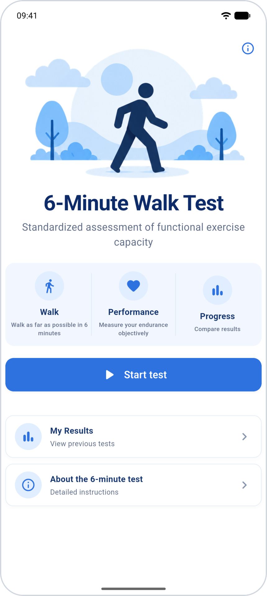
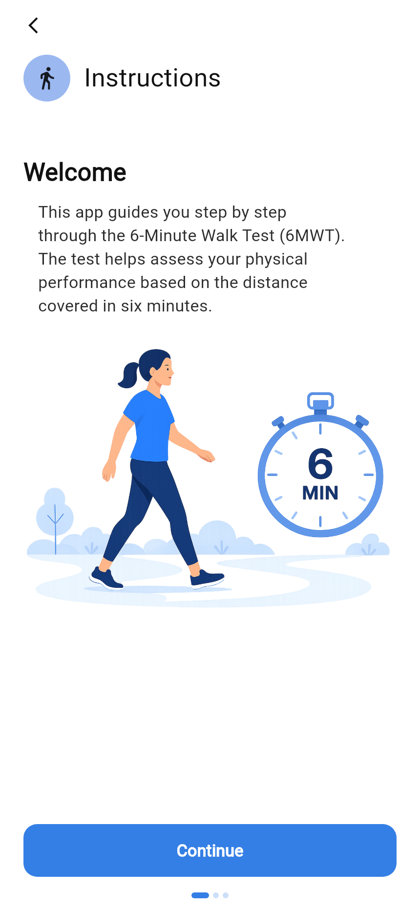
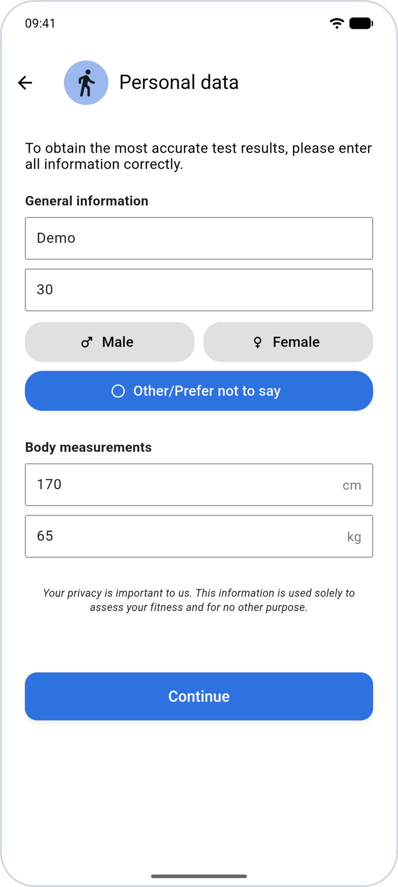
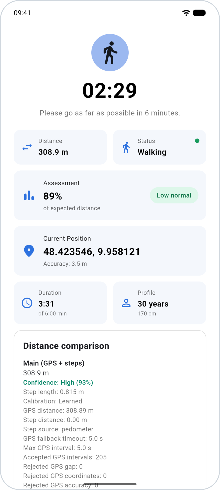
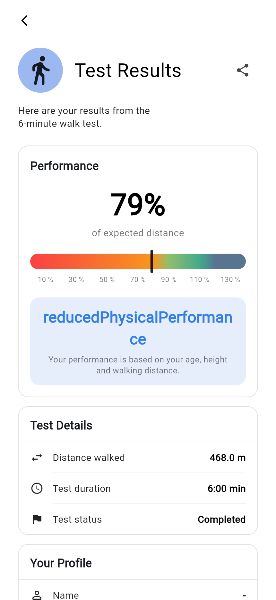
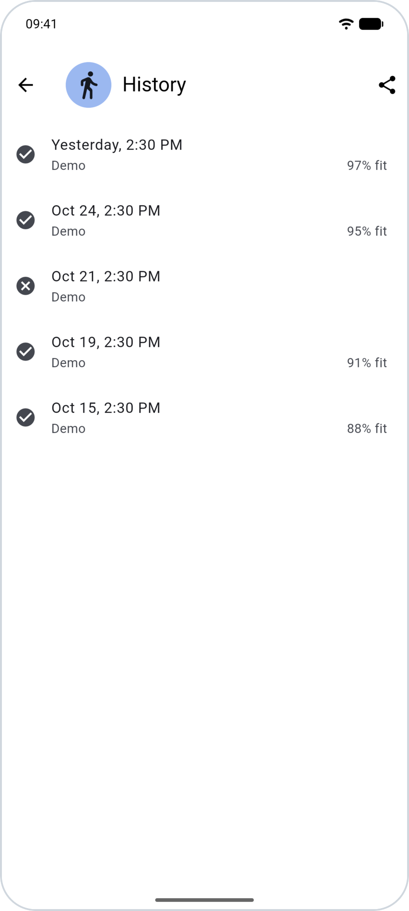

  
  

  
  
  
  
  

The six-minute walk test (6MWT) measures how far a person can walk in six minutes and is commonly used to assess functional exercise capacity.

This repository was developed as part of a Software Engineering project at Ulm University during the 2026 summer semester. Its mobile app records six-minute walk tests, estimates the distance covered and presents the result directly on the device.

Start, instructions and profile entry

  

Walking test, result and history

  

The mobile app provides:

- guided six-minute walk tests on Android and iOS;
- distance estimation using GPS and step data;
- an overview of completed and stopped tests;
- detailed results and optional recording exports.

[Install the app](wiki/App-Installation.md) to perform a six-minute walk test.

Browse [app/](app/README.md) for the mobile application, [tools/](tools/README.md) for development tools and helper scripts, and [data/](data/README.md) for example recordings. See [Development](wiki/Development.md) to work on the code.

The desktop Visualizer is a development tool for inspecting exported sensor data on maps and charts. It can also draw reference paths and replay different distance estimators to compare their behavior.

[Latest Release](https://github.com/SE-UUlm/6MWT/releases/latest) · [Wiki](https://github.com/SE-UUlm/6MWT/wiki)

Authors: **[Moritz Beck](https://github.com/Birkenstab), [Lea-Marie Kindermann](https://github.com/LeaMarieKindermann), [Luca-Marie Jamrosy](https://github.com/lucamariej), [Serhat Kan](https://github.com/Serhat310)**.

Licensed under [GPL-3.0-or-later](LICENSE). UI illustrations and app icons were generated using AI.
Screenshots show the actual interface.

### Documentation

All project documentation is maintained in the [Wiki](https://github.com/SE-UUlm/6MWT/wiki). Its source files live in [`wiki/`](wiki/) and are published automatically.

Please add or update detailed documentation there. Outside `wiki/`, keep only brief entry-point READMEs, linking to the relevant wiki pages.
