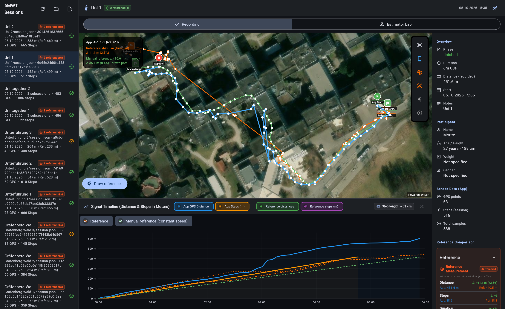
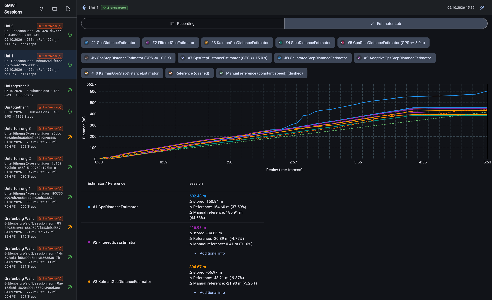

# 6MWT Visualizer

A desktop tool for inspecting app recordings, comparing reference routes and replaying distance estimators. This tool was created to aid in distance estimator development and tuning.

Available for Linux, macOS and Windows. Open app JSON exports or folders of recordings.

- **Recording:** satellite map, distance/step chart, sample details and reference comparisons.
- **References:** load watch recordings or draw routes on the map and save them alongside the source data.
- **Estimator Lab:** replay the app's actual algorithms, compare distance curves and inspect diagnostics. Algorithm selection and parameter variants are configured in code.
- **Multiple devices:** compare recordings from the same walk without combining their sensor streams.

The GPS/step estimator uses the recording's profile for its initial step length
before sensor calibration. See [Distance Estimators](../../wiki/Distance-Estimators.md#initial-step-length-from-profile-data)
for the formula and compatibility with older exports.

The [example data](../../data/README.md) is a useful starting point. Release archives contain the application but no recordings; satellite imagery requires internet access. Keep the entire extracted application bundle together.

[Latest Release](https://github.com/SE-UUlm/6MWT/releases/latest) · [Installation and use](../../wiki/Visualizer.md) · [Development](../../wiki/Development.md)
